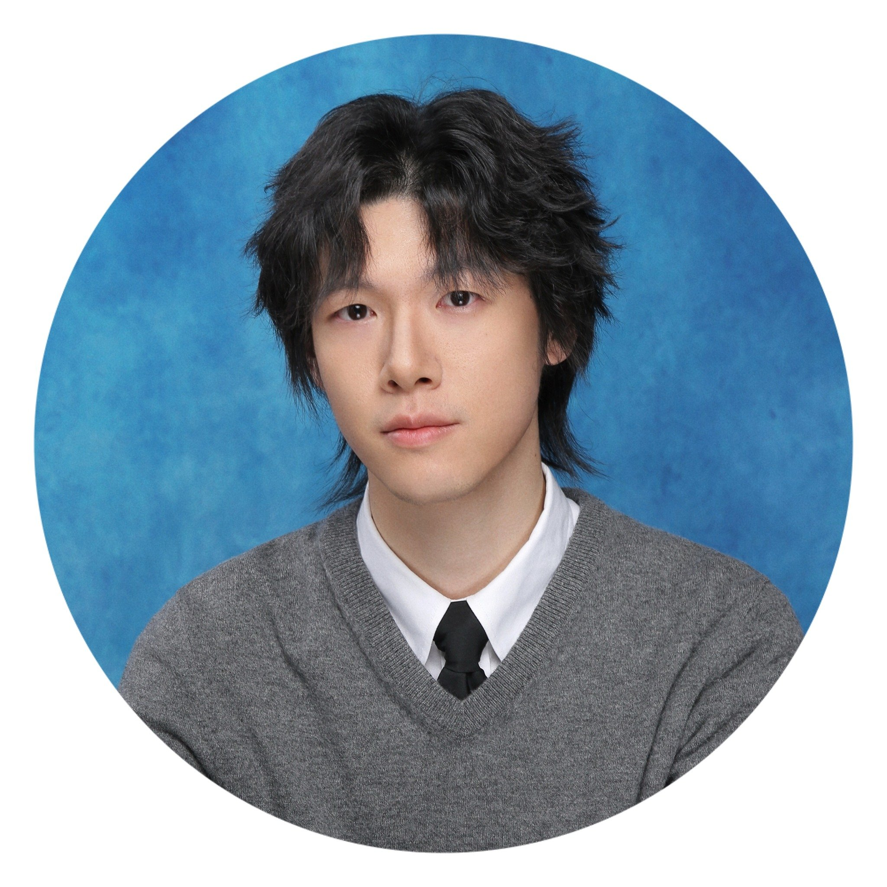

{width="200" style="float:left; margin-right:20px; margin-bottom:10px;"}

Welcome! This is Evelyn, Zihan Zhu.

I'm a [PhD student](https://gvpt.umd.edu/gradprofile/zhu/zihan) in Government and Politics at the University of Maryland, College Park with a primary field in International Relations and a secondary field in Comparative Politics. Prior to beginning doctoral studies, I was awarded Honors Bachelor of Arts by the University of Toronto, St. George's in June 2019, and received Master of Social Sciences from the University of Macau in June 2023.

Advised by Dr. [Todd Allee](https://gvpt.umd.edu/facultyprofile/allee/todd), I mainly study *the politics of international organizations* through the perspective of staffing and personnel decisions in the UN system. One of my current working papers asks how states steer the UN staffing composition, which states are more successful at shaping that composition and why.

I also pay attention to topics in international political economy, and particularly, how states strategically allocate aid, i.e., bilateral vs. multilateral, or bypassing state actors, to advance their foreign policy agenda and how effective such practices have been. I additionally take some interest in electoral politics and dynastic representation in democracies, and how institutional design shape these outcomes. For this part, I have a country-specific focus on Japan due to its uniqueness as a non-Western democracy.

I have been working as a research assistant to faculty on various projects broadly defined in the field of International Relations. Most recently, my co-authored work with Dr. [David Cunningham](http://www.davidcunninghampolisci.com/) on UN Special Political Missions is forthcoming in the *Journal of Peace Research.* I have been part of the [Networks of Influence and Support](https://www.ripilab.com/active-projects/networks-of-influence-and-support-between-war-and-peace) project for coding aid actors within conflict-affected contexts.

As a political scientist in an early career stage, I tend to keep things open. I'm also gradually building my CV and other relevant materials. Beyond my professional profile, I'm a dog person and a J-pop fan.
